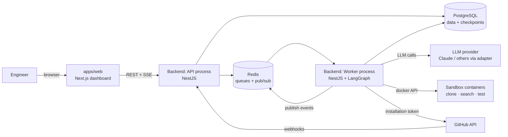
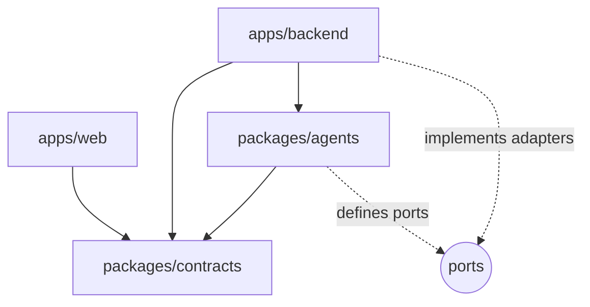
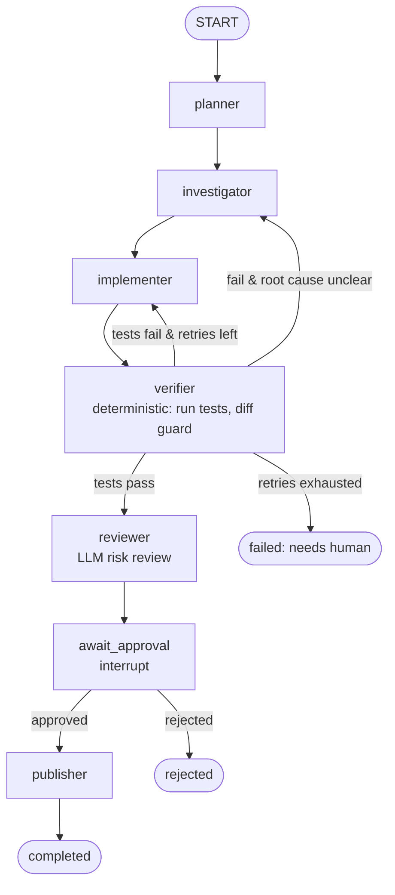
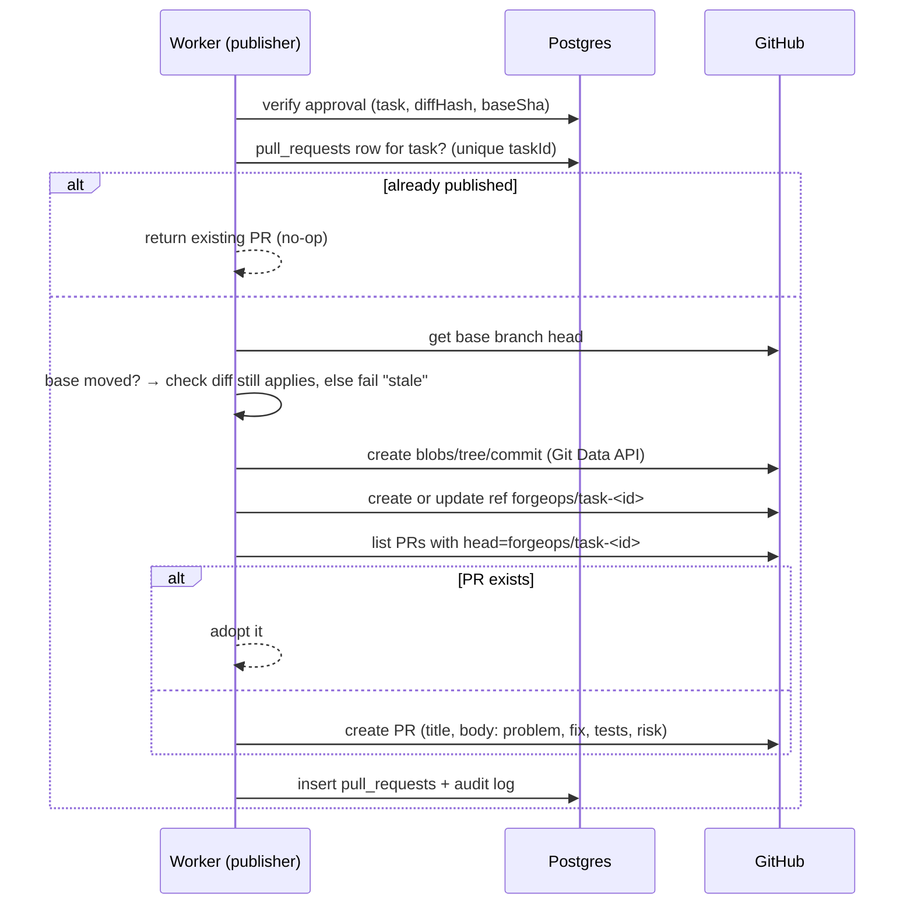
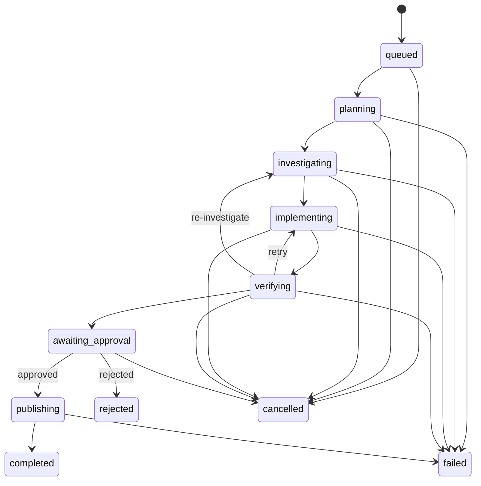

# ForgeOps — Architecture

> AI-powered software engineering automation: turn a natural-language task into a
> tested, reviewed, human-approved Pull Request — safely.

This document is the source of truth for **how ForgeOps is built and why**.
The step-by-step build order lives in [ROADMAP.md](./ROADMAP.md).

---

## 1. Guiding principles

| #   | Principle                                      | What it means in practice                                                                                                                 |
| --- | ---------------------------------------------- | ----------------------------------------------------------------------------------------------------------------------------------------- |
| 1   | **The AI proposes, the system decides**        | The LLM never changes task status, never picks shell commands, never publishes. Deterministic code does, after validating the LLM output. |
| 2   | **Nothing leaves the sandbox without a human** | Publishing a PR requires an approval bound to the exact diff hash and base commit.                                                        |
| 3   | **Every step is resumable**                    | Graph state is checkpointed in Postgres after every node. A crashed worker resumes; it doesn't restart.                                   |
| 4   | **Every side effect is idempotent**            | Retrying a job never creates a second branch, commit, or PR.                                                                              |
| 5   | **Repository content is untrusted data**       | Code, READMEs, and issues are treated as input, never as instructions (prompt-injection defence).                                         |
| 6   | **Least privilege everywhere**                 | Scoped GitHub App permissions, short-lived tokens, per-role tool allowlists, network-less test containers.                                |
| 7   | **Contract-first**                             | One set of Zod schemas defines API payloads, SSE events, and LLM outputs, shared by backend, agents, and frontend.                        |
| 8   | **Modular monolith first**                     | One backend codebase, two processes (API + Worker). Clear module boundaries make a later split possible but not required.                 |

**Non-goals (v1):** auto-merge, multi-tenant organisations/billing, supporting every language's toolchain, fixing every bug. ForgeOps knows when to **stop and ask**.

---

## 2. System context



- **API process** — auth, CRUD, approvals, SSE streaming, webhooks. Never runs agents or user code.
- **Worker process** — consumes BullMQ jobs, runs the LangGraph agent graph, drives the sandbox, talks to GitHub.
- **Sandbox** — one throwaway Docker container per operation, with no secrets, no network during tests, and strict resource limits.

---

## 3. Architectural style

ForgeOps combines three well-known styles, each solving a specific problem:

1. **Modular Monolith** (system level) — one NestJS codebase with feature modules
   (`tasks`, `approvals`, `github`, …) and **two entrypoints**: `api.main.ts` and `worker.main.ts`.
   You get simple local development and shared code, while the worker scales separately.
2. **Hexagonal / Ports & Adapters** (inside complex modules and the agents package) —
   business logic depends on _interfaces_ (ports) such as `LlmFactory`, `SandboxPort`, `GitHubPort`,
   `TaskLifecyclePort`. NestJS provides the _adapters_ (Docker, Octokit, Prisma). This is why the
   agent graph can be unit-tested with fakes and no Docker, GitHub, or real LLM.
3. **Event-driven workflow** (runtime) — HTTP requests enqueue jobs and return `202 Accepted`;
   the worker emits an append-only stream of `agent_events` that the UI follows via SSE.

### Dependency rule



- `contracts` depends only on `zod`.
- `agents` depends on `contracts` and LangGraph/LangChain. **It never imports NestJS, Prisma, Octokit, or Docker.**
- `backend` wires everything together. `web` never imports backend code, only contracts.
- These rules are enforced by ESLint `no-restricted-imports` presets in `packages/eslint-config/boundaries.js`, so `pnpm lint` fails on a wrong dependency direction.

---

## 4. Monorepo layout

pnpm workspaces + **Turborepo** (cached, dependency-aware `build` / `test` / `lint` pipelines).

```
forgeops/
├─ apps/
│  ├─ backend/                  NestJS — API + Worker (one codebase, two processes)
│  │  ├─ prisma/                schema.prisma, migrations, seed
│  │  ├─ src/
│  │  │  ├─ entrypoints/        api.main.ts, worker.main.ts
│  │  │  ├─ api.module.ts       root module for the API process
│  │  │  ├─ worker.module.ts    root module for the Worker process
│  │  │  ├─ common/             config (Zod-validated env), errors, filters, guards,
│  │  │  │                      interceptors (idempotency, logging), decorators
│  │  │  ├─ infrastructure/     prisma, redis, queue (BullMQ), observability, storage
│  │  │  └─ modules/
│  │  │     ├─ auth/            login, JWT + refresh rotation, guards
│  │  │     ├─ users/
│  │  │     ├─ github/          GitHub App client, token service, installations, webhooks
│  │  │     ├─ repositories/    linked repos, branches, settings (test command, limits)
│  │  │     ├─ tasks/           task use cases + task state machine
│  │  │     ├─ approvals/       approval binding + verification
│  │  │     ├─ events/          event store, Redis pub/sub, SSE controller
│  │  │     ├─ artifacts/       diffs, test logs, reports (DB or S3-compatible)
│  │  │     ├─ sandbox/         Docker runner, workspace manager   (worker only)
│  │  │     ├─ orchestrator/    BullMQ processors, AgentOrchestratorService,
│  │  │     │                   port adapters, Postgres checkpointer  (worker only)
│  │  │     └─ audit/           security audit log
│  │  └─ test/                  integration + e2e (Testcontainers)
│  └─ web/                      Next.js (App Router) dashboard
│     └─ src/
│        ├─ app/                routes: (auth), (dashboard)/…
│        ├─ features/           tasks/, repositories/, approvals/, auth/ …
│        │                      each: api.ts, hooks.ts, components/
│        ├─ components/ui/      shadcn/ui primitives
│        └─ lib/                api-client, sse, query-client, utils
├─ packages/
│  ├─ contracts/                Zod schemas + inferred types (API, SSE events, enums)
│  ├─ agents/                   LangGraph graph — framework-agnostic
│  │  └─ src/
│  │     ├─ graph/              build-graph.ts, edges/routing.ts
│  │     ├─ state/              state annotation + reducers
│  │     ├─ nodes/              planner, investigator, implementer, verifier,
│  │     │                      reviewer, await-approval, publisher
│  │     ├─ tools/              typed tools (Zod) + ToolRegistry per role
│  │     ├─ policies/           tool policy, budgets, path guard, diff guard
│  │     ├─ prompts/            versioned system prompts per role
│  │     ├─ outputs/            Zod schemas for structured LLM outputs
│  │     ├─ ports/              interfaces the backend must implement
│  │     └─ testing/            FakeChatModel, in-memory port fakes
│  ├─ tsconfig/                 shared TS configs
│  └─ eslint-config/            shared lint rules + boundary rules
├─ infra/
│  ├─ docker/                   docker-compose.yml, Dockerfiles, sandbox images
│  └─ github-app/               app manifest + setup guide
├─ evals/                       fixture repos with seeded bugs + eval runner (metrics)
├─ docs/                        ARCHITECTURE.md, ROADMAP.md, adr/
└─ .github/workflows/           CI: lint, typecheck, test, build
```

**Why `agents` is a separate package:** it's the core IP of the project. Isolating it from
NestJS means it can be tested in milliseconds with fakes, reused from a CLI or eval runner,
and explained in an interview as clean, standalone architecture.

---

## 5. Backend design (NestJS)

### 5.1 Module anatomy

Not every module needs the same depth. Simple CRUD modules stay thin; modules with real
business rules get layers:

```
modules/tasks/
├─ tasks.module.ts
├─ http/
│  └─ tasks.controller.ts         thin: parse DTO → call use case → map response
├─ application/                   use cases (one class per action)
│  ├─ create-task.use-case.ts
│  ├─ cancel-task.use-case.ts
│  └─ get-task.query.ts
├─ domain/                        pure TypeScript, no Nest/Prisma imports
│  ├─ task-status.ts              the state machine (see §9)
│  └─ task.errors.ts
└─ infrastructure/
   └─ prisma-task.repository.ts   implements TaskRepository port
```

| Depth                       | Modules                                                 |
| --------------------------- | ------------------------------------------------------- |
| Full layering               | `tasks`, `approvals`, `orchestrator`, `github`          |
| Thin (controller + service) | `users`, `repositories`, `artifacts`, `audit`, `events` |

### 5.2 Cross-cutting concerns

| Concern       | Implementation                                                                                                                                   |
| ------------- | ------------------------------------------------------------------------------------------------------------------------------------------------ |
| Config        | `@nestjs/config` + Zod schema → app refuses to boot on invalid env                                                                               |
| Validation    | `nestjs-zod`: DTOs created from `packages/contracts` schemas; also generates Swagger                                                             |
| Errors        | Domain errors → `DomainExceptionFilter` → RFC 7807 `application/problem+json`                                                                    |
| AuthN         | Access JWT (15 min, httpOnly cookie) + rotating refresh token (hashed in `sessions`)                                                             |
| AuthZ         | `JwtAuthGuard` globally + ownership policies (`TaskAccessPolicy`) in use cases. Every query is scoped by `userId`.                               |
| Idempotency   | `IdempotencyInterceptor` on `POST /tasks` and `/approve`: `Idempotency-Key` + request hash stored in Redis (24h) → replays the original response |
| Rate limiting | `@nestjs/throttler` (Redis store)                                                                                                                |
| Logging       | `nestjs-pino` with `taskId` / `runId` / `traceId` in every line + redaction of tokens and keys                                                   |
| Tracing       | OpenTelemetry SDK (HTTP, Prisma, BullMQ, LLM spans) → OTLP exporter                                                                              |
| Docs          | Swagger at `/api/docs`, versioned routes `/api/v1/...`                                                                                           |

### 5.3 Worker process

`worker.main.ts` boots `WorkerModule` with `NestFactory.createApplicationContext()`, so it has no HTTP server.

| Queue         | Job                 | jobId (dedupe)        | Purpose                              |
| ------------- | ------------------- | --------------------- | ------------------------------------ |
| `agent-runs`  | `run.start`         | `start:<taskId>`      | Start the graph for a new task       |
| `agent-runs`  | `run.resume`        | `resume:<approvalId>` | Resume after approval/rejection      |
| `maintenance` | `workspace.cleanup` | repeatable            | Delete expired workspaces/containers |

- **Concurrency** per worker is configurable (default 2 graphs at once).
- **Retries:** BullMQ `attempts: 3` with exponential backoff. A retry calls the graph with the **same
  `thread_id`** and `null` input, so LangGraph **resumes from the last checkpoint**.
- **Stalled jobs** (worker crashed) are picked up again by BullMQ and resume the same way.
- **Cancellation:** the API sets `tasks.cancelRequestedAt`. The worker checks it between nodes and
  passes an `AbortSignal` into LLM calls and sandbox runs.

---

## 6. Agent orchestrator (`packages/agents`)

### 6.1 The graph



| Node             | Kind                        | Allowed tools                                                                          | Output (Zod-validated)                                                            |
| ---------------- | --------------------------- | -------------------------------------------------------------------------------------- | --------------------------------------------------------------------------------- |
| `planner`        | LLM, structured output      | `repo.tree`, `repo.metadata`                                                           | `Plan { goal, steps[], suspectedAreas[], acceptanceCriteria[] }`                  |
| `investigator`   | LLM tool loop (max N calls) | `repo.read_file`, `repo.search`, `repo.tree`                                           | `Findings { rootCause, evidence[{file,lines,why}], filesToChange[], confidence }` |
| `implementer`    | LLM tool loop               | `workspace.read_file`, `workspace.edit_file` (search/replace), `workspace.create_file` | `ImplementationSummary { changes[], testsAdded[] }`                               |
| `verifier`       | **Deterministic** (no LLM)  | `sandbox.run_tests` (command from repo settings), `git.diff`                           | `Verification { passed, testResults, diffStats, guardViolations[] }`              |
| `reviewer`       | LLM, structured output      | none (receives diff + results)                                                         | `Review { risk: low/medium/high, findings[], recommendation }`                    |
| `await_approval` | `interrupt()`               | —                                                                                      | resumes with `{ decision, approvalId }`                                           |
| `publisher`      | **Deterministic**           | `GitHubPort` (branch, commit, PR)                                                      | `{ pullRequestUrl, number }`                                                      |

Agents are **roles** (prompt + tool set + output schema), not separate programs. They can share one
model or use different models per role (for example, a cheaper model for planning and review).

### 6.2 State

```ts
// packages/agents/src/state/agent-state.ts (sketch)
export const AgentState = Annotation.Root({
  taskId: Annotation<string>(),
  runId: Annotation<string>(), // = LangGraph thread_id
  repository: Annotation<RepoRef>(), // { id, owner, name, baseBranch }
  baseCommitSha: Annotation<string>(),
  instruction: Annotation<string>(),
  plan: Annotation<Plan | null>(),
  findings: Annotation<Findings | null>(),
  changedFiles: Annotation<string[]>({ reducer: union, default: () => [] }),
  diffArtifactId: Annotation<string | null>(), // big data → artifact store, only the id lives here
  diffHash: Annotation<string | null>(),
  testResults: Annotation<TestRunSummary[]>({ reducer: append, default: () => [] }),
  review: Annotation<Review | null>(),
  approval: Annotation<ApprovalRef | null>(),
  pullRequest: Annotation<PullRequestRef | null>(),
  retryCount: Annotation<number>({ default: () => 0 }),
  budget: Annotation<BudgetUsage>(), // tokens, cost, tool calls, wall time
});
```

**Rules:** state must be serialisable and small. It never contains tokens, API keys, or full
file contents. Large data (diffs, logs) goes to the artifact store, and the state keeps only the id.

### 6.3 Ports (what the backend must provide)

```ts
interface LlmFactory {
  forRole(role: AgentRole): BaseChatModel;
} // provider adapter
interface RepoReaderPort {
  tree();
  readFile(path, range?);
  search(query);
} // reads sandbox workspace
interface WorkspacePort {
  editFile(path, search, replace);
  createFile();
  diff();
}
interface SandboxPort {
  runTests(workspaceId, signal): TestRunResult;
}
interface GitHubPort {
  publish(input: PublishInput): PullRequestRef;
} // idempotent
interface TaskLifecyclePort {
  transition(taskId, to: TaskStatus);
  isCancelRequested(taskId);
}
interface EventSinkPort {
  emit(event: AgentEvent);
}
interface ArtifactPort {
  put(taskId, kind, content): id;
  get(id);
}
interface ApprovalPort {
  verify(approvalId, diffHash, baseSha): VerifiedApproval;
}
```

### 6.4 Provider adapter

LangChain chat models (`@langchain/anthropic`, `@langchain/openai`, …) already share one interface
(`BaseChatModel` with `.bindTools()` and `.withStructuredOutput(zodSchema)`). `LlmFactory` reads
config such as `LLM_PROVIDER` and `LLM_MODEL_<ROLE>` and returns the right model. Switching providers
is a config change. A `FakeChatModel` with scripted responses powers deterministic tests.

### 6.5 Tools and the policy layer

Every tool is a small class with a Zod input schema. Before it runs, the call goes through `ToolPolicy`:

```
LLM tool call → schema validation → ToolPolicy.check(role, tool, args, budget)
             → PathGuard (inside workspace? not in denylist?) → execute → truncate output → event
```

- **Per-role allowlist:** the investigator can't edit, and the implementer can't run tests or reach GitHub.
- **PathGuard:** resolves real paths and rejects `..`, symlinks out of the workspace, and denied
  paths (`.git/`, `.github/workflows/`, `.env*`, keys, lockfiles unless allowed).
- **DiffGuard** (in the verifier): max files changed, max lines, no binary files, and a secret-pattern scan.
- **Budgets:** max LLM tokens/cost, max tool calls per node, max total wall time, max retries.
  If a budget is exceeded, the run fails with `budget_exceeded` (it never silently continues).
- **No free-form shell.** The test command comes from repository settings set by a human,
  never from the LLM.

### 6.6 Prompt-injection defence

- Repository content is wrapped in clearly delimited `<untrusted_file path="…">` blocks. The system
  prompt states that the content is data and that any instructions inside it must be ignored.
- The LLM has **no tool that can cause harm outside the workspace**. Even a fully hijacked model can
  only edit sandbox files, which a human then reviews.
- Deterministic gates (verifier, DiffGuard, approval binding) don't trust LLM claims.
  "Tests pass" is checked by actually running them.
- An injection test suite in `evals/` checks that malicious READMEs and comments don't change behaviour.

### 6.7 Human-in-the-loop (interrupt / resume)

1. `await_approval` calls `interrupt({ diffHash, baseCommitSha })`. The checkpoint is saved, the job
   finishes, and the task moves to `awaiting_approval`.
2. The user reviews and calls `POST /tasks/:id/approve` with the `diffHash` they saw.
3. The API verifies ownership, status, and that the hash matches the stored diff. It then inserts an
   `approvals` row and enqueues `run.resume`.
4. The worker calls `graph.invoke(new Command({ resume: { approvalId } }), { thread_id: runId })`.
5. The `publisher` **re-verifies** the approval from the DB (it doesn't trust graph state) and checks
   that the base branch hasn't moved in a way that conflicts with the diff.

**Checkpointer:** `@langchain/langgraph-checkpoint-postgres` (`PostgresSaver`) in a separate
`langgraph` schema of the same database. `MemorySaver` is used only in unit tests.

---

## 7. Sandbox & workspaces

```
Task workspace lifecycle
create volume → clone (network ON, git hooks disabled, token via one-shot credential helper)
            → strip remote credentials → install deps (network via registry allowlist, optional)
            → [agent reads/edits files through worker tools]
            → run tests (network OFF) → produce diff → keep until published/expired → destroy
```

Container hardening for every run:

| Control      | Setting                                                                                      |
| ------------ | -------------------------------------------------------------------------------------------- |
| User         | non-root (`uid 1000`), `--cap-drop=ALL`, `no-new-privileges`                                 |
| Filesystem   | read-only root, writable only `/workspace` volume + `/tmp` tmpfs                             |
| Resources    | `--memory`, `--cpus`, `--pids-limit`, hard timeout (kill)                                    |
| Network      | `--network=none` for test runs                                                               |
| Secrets      | none: no env passthrough, no Docker socket, no GitHub token                                  |
| Clone safety | `git -c core.hooksPath=/dev/null clone --depth 1 --no-recurse-submodules` at `baseCommitSha` |
| Output       | stdout/stderr capped (for example 1 MB) and truncated before it goes to the LLM              |

> Docker is an isolation layer, not a perfect security boundary. The worker host should be dedicated.
> A stronger runtime such as gVisor (`runsc`) is a documented upgrade path.

---

## 8. GitHub integration

- **GitHub App** ("ForgeOps"), with permissions: Metadata R, Contents R/W, Pull requests R/W, Checks R (optional).
  No Administration, no merge.
- **Installation tokens** are minted just in time by `GitHubTokenService` (cached in memory under 1h)
  and used only inside adapters. They never go into graph state, logs, LLM prompts, or the sandbox env.
- The App private key comes from env/secret manager (a file mount in dev), never from the DB.
- **Webhooks** are verified with HMAC (`X-Hub-Signature-256`) and deduplicated by `X-GitHub-Delivery`.
  They handle installation added/removed, repos added/removed, and PR closed/merged.

### Publish flow (idempotent)



Deterministic branch names and "look before you create" checks make every step safe to repeat.

---

## 9. Task lifecycle (state machine)



- The transition table lives in `tasks/domain/task-status.ts` as pure data plus an `assertTransition()` function.
- Updates use **optimistic locking** (`UPDATE … WHERE id = ? AND version = ?`). A lost race fails loudly.
- Clients can never set status directly. They call intent endpoints (`cancel`, `approve`, `reject`).
- `failed` stores `failureReason` (`budget_exceeded`, `tests_failed`, `stale_base`, `sandbox_error`, …)
  and `retryable`.

---

## 10. Data model (PostgreSQL + Prisma)

| Table                  | Key columns                                                                                                                  | Notes                             |
| ---------------------- | ---------------------------------------------------------------------------------------------------------------------------- | --------------------------------- |
| `users`                | id, email, passwordHash?, githubUserId?                                                                                      |                                   |
| `sessions`             | id, userId, refreshTokenHash, expiresAt, revokedAt                                                                           | refresh rotation                  |
| `github_installations` | id, installationId (unique), accountLogin, accountType, userId                                                               |                                   |
| `repositories`         | id, installationId, githubRepoId (unique), owner, name, defaultBranch, settings (json: testCommand, limits)                  |                                   |
| `tasks`                | id, userId, repositoryId, instruction, baseBranch, baseCommitSha, status, version, failureReason, costUsd, cancelRequestedAt | index (userId, createdAt)         |
| `agent_runs`           | id (= thread_id), taskId, attempt, status, startedAt, endedAt                                                                |                                   |
| `agent_events`         | id, taskId, runId, **seq** (per task), type, node, payload json, createdAt                                                   | append-only; unique (taskId, seq) |
| `task_artifacts`       | id, taskId, kind (diff/test_log/report), storage (db/s3), content/uri, sha256, size                                          |                                   |
| `approvals`            | id, taskId, userId, decision, **diffHash**, **baseCommitSha**, comment, createdAt                                            | approval bound to exact changes   |
| `pull_requests`        | id, taskId (**unique**), number, url, branch, headSha                                                                        | idempotency anchor                |
| `audit_logs`           | id, actorId, action, targetType, targetId, metadata, ip, createdAt                                                           | approvals, publishes, installs    |
| `idempotency_keys`     | key, userId, requestHash, response, expiresAt                                                                                | (or Redis)                        |

LangGraph checkpoint tables live in a separate `langgraph` schema, managed by `PostgresSaver.setup()`.

---

## 11. Real-time events (SSE)

```
Worker node → EventSinkPort.emit()
   → INSERT agent_events (seq = next per task)       ← durable source of truth
   → PUBLISH redis "task-events:<taskId>"            ← fast fan-out
API GET /tasks/:id/events (SSE)
   → on connect: replay events WHERE seq > Last-Event-ID
   → then stream live from Redis subscription
```

The `agent_events` table doubles as the **outbox**. If Redis drops a message, the client reconnects
with `Last-Event-ID` and the DB replay fills the gap, so no event is lost. Event payloads are a
discriminated union in `packages/contracts` (`node.started`, `tool.called`, `tool.result`,
`status.changed`, `test.result`, `approval.required`, `pr.created`, `run.failed`, …).

---

## 12. Frontend (apps/web)

- **Next.js App Router + TypeScript, Tailwind CSS, shadcn/ui, TanStack Query.**
- **Feature folders:** `features/tasks/{api.ts, hooks.ts, components/}`, so route files stay thin.
- **Typed API client:** a `fetch` wrapper that parses every response with the `contracts` Zod schema.
  Backend and frontend can't drift apart silently.
- **Live updates:** `useTaskEvents(taskId)` opens an `EventSource` and writes into the TanStack Query
  cache (timeline + status), with automatic reconnect and `Last-Event-ID` replay.
- **Auth:** httpOnly cookies set by the API. Next.js `middleware.ts` redirects unauthenticated users.
  Mutations send a custom header for CSRF defence together with `SameSite=Lax`.
- **Key screens:** dashboard, repositories, new task, task timeline (live agent steps), review
  (diff viewer + test results + risk + cost → Approve/Reject), integrations.

| Route                    | Purpose                              |
| ------------------------ | ------------------------------------ |
| `/login`                 | sign in                              |
| `/dashboard`             | stats + recent tasks                 |
| `/repositories`          | linked repos, install GitHub App     |
| `/tasks/new`             | create task                          |
| `/tasks/[id]`            | live timeline of agents, tools, logs |
| `/tasks/[id]/review`     | diff, tests, review, approve/reject  |
| `/settings/integrations` | installations & permissions          |

---

## 13. Security model (threat → control)

| Threat                                                | Control                                                                                   |
| ----------------------------------------------------- | ----------------------------------------------------------------------------------------- |
| Prompt injection from repo content                    | Untrusted-data framing, no dangerous tools, deterministic gates, human approval           |
| Malicious code in tests (exfiltration, crypto-mining) | Network-less, non-root, resource-limited, secret-free containers + timeouts               |
| Path traversal / symlink escape                       | PathGuard with realpath resolution + denylist                                             |
| Approving one diff, publishing another                | Approval bound to `diffHash` + `baseCommitSha`, re-verified at publish                    |
| Duplicate PRs on retry                                | Unique `pull_requests.taskId`, deterministic branch, look-before-create                   |
| Token leakage                                         | Just-in-time installation tokens, adapter-only use, Pino redaction, never in state/prompt |
| User accessing another user's tasks                   | Ownership checks in every use case, scoped queries, tests for IDOR                        |
| Forged webhooks                                       | HMAC signature verification + delivery-id dedupe                                          |
| Runaway cost                                          | Per-task budgets (tokens, $, tool calls, time), per-user rate limits                      |
| Unaccountable actions                                 | `audit_logs` for approvals, publishes, installation changes                               |

---

## 14. Observability

- **Logs:** Pino JSON with `traceId`, `taskId`, `runId`, `node`. Redaction paths for `authorization`,
  `token`, `privateKey`, `apiKey`.
- **Traces:** OpenTelemetry. A span tree per task: job → node → LLM call / tool call / sandbox run.
- **Metrics (from DB + traces):** task completion rate, retries per task, cost per task, time per task,
  duplicate PR count (must be 0), and resume-after-crash success.
- **Cost ledger:** a LangChain callback records token usage per LLM call → `agent_events` + `tasks.costUsd`.

---

## 15. Testing strategy

| Layer         | Tooling                                 | Examples                                                                              |
| ------------- | --------------------------------------- | ------------------------------------------------------------------------------------- |
| Unit (domain) | Jest                                    | state machine transitions, PathGuard, DiffGuard, diff hashing, budgets                |
| Unit (agents) | Jest + `FakeChatModel` + port fakes     | routing after test failure, retry limits, interrupt/resume, invalid LLM JSON handling |
| Integration   | Jest + Testcontainers (Postgres, Redis) | create task → job enqueued, approval flow, SSE replay, checkpoint resume              |
| GitHub        | Octokit mocked with `nock`              | idempotent publish, expired token refresh, webhook signature                          |
| Sandbox       | real Docker (CI job)                    | timeout kill, network blocked, path escape blocked                                    |
| E2E           | Playwright                              | create task → watch timeline → approve → PR link (fake LLM + fake GitHub)             |
| Evals         | `evals/` runner                         | real LLM on fixture repos with seeded bugs → success rate, cost, time                 |

---

## 16. Design-pattern catalogue

| Pattern                             | Where                                                    | Why                                                       |
| ----------------------------------- | -------------------------------------------------------- | --------------------------------------------------------- |
| Modular Monolith                    | `apps/backend` modules                                   | Simple to build, deploy, and test; split-ready            |
| Ports & Adapters (Hexagonal)        | `packages/agents/ports`, backend adapters                | Agent logic is testable and infrastructure is swappable   |
| Use Case / Application Service      | `modules/*/application`                                  | One class per business action; controllers stay thin      |
| Repository                          | `infrastructure/prisma-*.repository.ts`                  | Domain is isolated from Prisma; easy to fake              |
| State Machine                       | `tasks/domain/task-status.ts`                            | Illegal transitions become impossible, not just unlikely  |
| Strategy + Factory                  | `LlmFactory`, per-role model selection                   | Change provider or model with config                      |
| Adapter                             | Octokit, Docker, S3 wrappers                             | External APIs hidden behind project-shaped interfaces     |
| Command / Message Queue             | BullMQ jobs                                              | Long work stays off the HTTP request; retries and backoff |
| Transactional Outbox (lite)         | `agent_events` + Redis pub/sub                           | Reliable, replayable real-time events                     |
| Idempotency Key                     | HTTP interceptor + publish anchors                       | Retries are safe at every layer                           |
| Optimistic Locking                  | `tasks.version`                                          | Concurrent workers or requests can't corrupt status       |
| Chain of Responsibility             | Tool call pipeline (validate → policy → guard → execute) | Composable, testable safety checks                        |
| Policy Object                       | `ToolPolicy`, `TaskAccessPolicy`, `ApprovalPolicy`       | Authorization rules in one named, testable place          |
| Checkpoint / Memento                | LangGraph `PostgresSaver`                                | Crash recovery and human-in-the-loop pauses               |
| Guard / Interceptor / Filter (Nest) | auth, idempotency, logging, errors                       | Cross-cutting concerns kept out of business code          |
| Contract-first / Shared Kernel      | `packages/contracts`                                     | One schema validates API, SSE, and frontend               |

---

## 17. Key decisions (ADR summary)

Full ADRs go in `docs/adr/` as decisions are made.

1. **Modular monolith with two processes** rather than microservices: complexity isn't justified yet.
2. **LangGraph.js** rather than a hand-rolled loop: checkpoints, interrupts, and conditional edges come built in.
3. **Clone into a sandbox** rather than reading via the REST API: real search plus running tests needs a working tree.
   The REST/Git Data API is used for publishing.
4. **Git Data API for commits** rather than `git push` from the sandbox: the token never enters a container.
5. **Deterministic verifier and publisher:** the LLM is used only where judgement is needed.
6. **Zod everywhere** (env, DTOs, SSE, LLM outputs): one validation language from edge to core.
7. **Same Postgres for app data and checkpoints** (separate schema): one less service to run.
